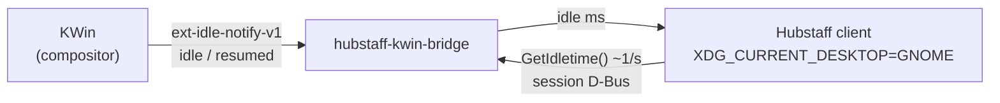

<div align="center">

# hubstaff-kwin-bridge

**Make the Hubstaff desktop client record keyboard and mouse activity on KDE Plasma (Wayland).**

No patching Hubstaff. No extra steps after install. Open Hubstaff from the app menu and your activity shows up.

[](https://github.com/DanielEsc0911/hubstaff-kwin-bridge/actions/workflows/ci.yml)
[](LICENSE)


[Quick start](#quick-start) · [How it works](#how-it-works) · [Troubleshooting](docs/troubleshooting.md) · [Install with an AI agent](#install-with-an-ai-agent)

</div>

---

## The problem

On KDE Plasma with Wayland, the Hubstaff Linux client tracks time and takes
screenshots, but **activity stays at 0%**. Hubstaff reads input activity in
only two ways on Linux:

| Source | Works on KDE Wayland? |
|---|---|
| X11 `XScreenSaver` extension (via XWayland) | ❌ `XScreenSaver extension not available` |
| GNOME Mutter `org.gnome.Mutter.IdleMonitor` over D-Bus | ❌ only used on GNOME, and KDE doesn't provide it |

## The fix

`hubstaff-kwin-bridge` is a tiny daemon (one C file) that provides
`org.gnome.Mutter.IdleMonitor` on KDE, using KWin's standard Wayland idle
protocol (`ext-idle-notify-v1`) as its data source. A small launcher makes
Hubstaff treat the session as GNOME, so it asks the bridge for the idle time.



- ✅ **Real input only.** The bridge reports the compositor's real
  keyboard/mouse idle state. It never makes up activity, and video playback
  doesn't count as input.
- ✅ **Transparent.** Starts on demand through D-Bus activation. Hubstaff's
  menu entry is patched once and re-patched automatically after Hubstaff
  updates.
- ✅ **Inert elsewhere.** On X11 sessions, GNOME or any non-KDE desktop, the
  launcher passes straight through and nothing changes.
- ✅ **Per-user, no root.** Everything goes under `~/.local` and
  `~/.config`. `make uninstall` reverts all of it.

## Requirements

- KDE Plasma 6 on Wayland (any KWin that supports `ext_idle_notifier_v1`)
- Hubstaff desktop client for Linux, per-user install (default: `~/Hubstaff/`)
- systemd user session and a D-Bus session bus (standard on every major distro)
- Build tools: a C compiler, `make`, `pkg-config`, GLib/GIO, libwayland,
  `wayland-scanner`, and **wayland-protocols ≥ 1.40**

<details>
<summary><b>Install build dependencies</b></summary>

```sh
# Fedora
sudo dnf install gcc make pkgconf-pkg-config glib2-devel wayland-devel wayland-protocols-devel

# Arch / Manjaro / EndeavourOS
sudo pacman -S --needed base-devel glib2 wayland wayland-protocols

# openSUSE Tumbleweed
sudo zypper install gcc make pkgconf glib2-devel wayland-devel wayland-protocols-devel

# Debian testing / recent Ubuntu (check that wayland-protocols is >= 1.40)
sudo apt install build-essential pkg-config libglib2.0-dev libwayland-dev wayland-protocols
```

Check your wayland-protocols version with `pkg-config --modversion wayland-protocols`.

</details>

## Quick start

```sh
git clone https://github.com/DanielEsc0911/hubstaff-kwin-bridge.git
cd hubstaff-kwin-bridge
make && make install      # per-user, do NOT use sudo
make doctor               # verify the install
```

Then **quit Hubstaff from its tray icon and open it again from the Plasma app
menu.** That's all. Start the timer and use your keyboard and mouse as usual.
The next 10-minute block shows non-zero activity.

> [!TIP]
> Run `make doctor` again after reopening Hubstaff. It checks that the running
> Hubstaff processes actually use the bridge.

### Uninstall

```sh
make uninstall
```

This removes every installed file, restores Hubstaff's original `Exec=` line
and stops the services. Restart Hubstaff afterwards.

## Install with an AI agent

This repository ships an [`AGENTS.md`](AGENTS.md) with a step-by-step install
playbook for coding agents (Claude Code, Codex, Cursor, Aider, …): what to
check first, which commands need you, how to verify, and what never to touch.
From a clone of the repo:

```text
Install this project for me following AGENTS.md, then verify it with make doctor.
```

## How it works

| Piece | What it does |
|---|---|
| [`src/hubstaff-kwin-bridge.c`](src/hubstaff-kwin-bridge.c) | Daemon. Subscribes to a 1-second input-idle notification from KWin and answers `GetIdletime` (plus the rest of the Mutter IdleMonitor API) on the session bus. |
| [`data/hubstaff-kwin-launch`](data/hubstaff-kwin-launch) | Wrapper prefixed to Hubstaff's `Exec=`. On KDE Wayland only, it sets `XDG_CURRENT_DESKTOP=GNOME` for Hubstaff so it picks its Mutter provider. |
| [`data/hubstaff-kwin-patch`](data/hubstaff-kwin-patch) + `.path` unit | Idempotently inserts the wrapper into Hubstaff's menu and autostart entries, and re-runs whenever Hubstaff rewrites them. |
| [`data/org.gnome.Mutter.IdleMonitor.service`](data/org.gnome.Mutter.IdleMonitor.service) + systemd unit | D-Bus activation: the bridge starts when Hubstaff first calls it. |
| [`tools/doctor.sh`](tools/doctor.sh) | Read-only health check (`make doctor`). |
| [`tools/probe_idlemonitor.py`](tools/probe_idlemonitor.py) | Reverse-engineering stub that logs which IdleMonitor methods Hubstaff calls. |

Full write-up, including how Hubstaff's providers were identified:
**[docs/how-it-works.md](docs/how-it-works.md)**.

## Compatibility

| | Status |
|---|---|
| Fedora 44, Plasma 6.7, Hubstaff 1.9.8 | ✅ Tested: activity recorded, screenshots via portal still work |
| Other distros with Plasma 6 on Wayland | 🟡 Expected to work, reports welcome |
| Plasma on X11 / XFCE / other X11 desktops | ➖ Not needed (Hubstaff works natively), bridge stays inert |
| GNOME | ➖ Not needed (Mutter is the real IdleMonitor) |
| Sway, Hyprland, other wlroots compositors | ❔ Untested. The bridge would work, but the launcher only switches on KDE |

## Known limitations

- **Keyboard vs. mouse split.** The Mutter interface only exposes idle time,
  so Hubstaff can't tell keyboard from mouse input. The overall activity %
  is correct.
- **App/URL tracking.** On Wayland Hubstaff needs its GNOME Shell extension
  for this, and KDE has no equivalent. This was already broken before the
  bridge (`Unkown application record` in the log).
- **Already-running Hubstaff.** A client started without the launcher keeps
  using the X11 provider until you restart it from the menu.

## FAQ

<details>
<summary><b>Is this an activity faker?</b></summary>

No. The bridge only passes on what KWin reports about real keyboard/mouse
input. If you're idle, Hubstaff sees you as idle. It uses the input-only
variant of the idle protocol, so even idle inhibitors (video players, presentations)
don't count as activity.
</details>

<details>
<summary><b>Does spoofing <code>XDG_CURRENT_DESKTOP=GNOME</code> break anything?</b></summary>

Only Hubstaff's own process tree gets the variable. Your Plasma session is
untouched. In testing, Hubstaff still captures screenshots through
xdg-desktop-portal and doesn't prompt to install its GNOME Shell extension.
</details>

<details>
<summary><b>What happens when Hubstaff updates?</b></summary>

Updates can rewrite the desktop entry. A systemd path unit notices and puts the
launcher back in automatically. Nothing about Hubstaff's binaries is modified.
</details>

<details>
<summary><b>Hubstaff is installed system-wide (/opt, /usr/share/applications)</b></summary>

See [docs/troubleshooting.md](docs/troubleshooting.md#system-wide-hubstaff-install).
</details>

## Contributing

Bug reports and PRs are welcome. Please include `make doctor` output. See
[CONTRIBUTING.md](CONTRIBUTING.md) and [docs/development.md](docs/development.md).

## License

[MIT](LICENSE). This project is not affiliated with, endorsed by, or supported
by Hubstaff or Netsoft. "Hubstaff" is a trademark of its respective owner.
