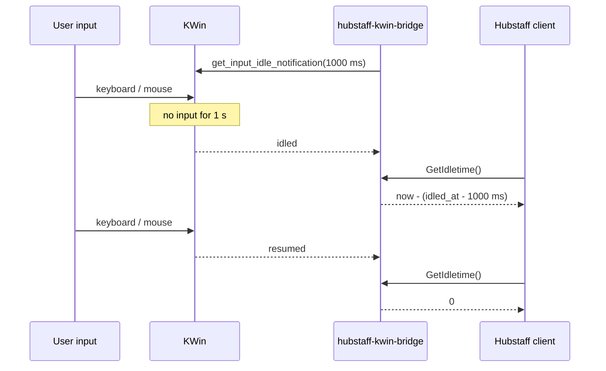
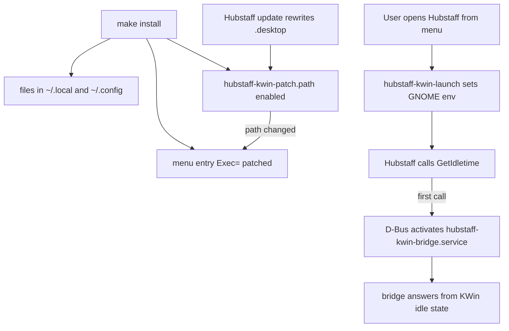

# How it works

This page explains why Hubstaff records no activity on KDE Wayland, how that
was worked out, and how each piece of the bridge fills the gap.

- [Why activity is 0% on KDE Wayland](#why-activity-is-0-on-kde-wayland)
- [The approach](#the-approach)
- [The bridge daemon](#the-bridge-daemon)
- [Getting Hubstaff to use it transparently](#getting-hubstaff-to-use-it-transparently)
- [Lifecycle](#lifecycle)
- [Side effects that were checked](#side-effects-that-were-checked)
- [How the Hubstaff side was reverse-engineered](#how-the-hubstaff-side-was-reverse-engineered)

## Why activity is 0% on KDE Wayland

Wayland deliberately doesn't let one application observe another
application's input. So "has the user touched the keyboard or mouse?" has to
come from the compositor, and every desktop exposes it differently.

Hubstaff's Linux client (closed source, 1.9.8 at the time of writing) has an
activity sampler, `core::providers::linux::InputImpl<T>::GetActivity(bool& kb,
bool& mouse)`, with exactly two backends:

| Provider | Mechanism | On KDE Wayland |
|---|---|---|
| `XScreenSaver` | `XScreenSaverQueryInfo()` against the X server (XWayland) | XWayland doesn't offer the extension. Log: `XScreenSaver extension not available` |
| `Mutter` | D-Bus call `org.gnome.Mutter.IdleMonitor.GetIdletime() → t` (ms) on `/org/gnome/Mutter/IdleMonitor/Core` | Never selected: chosen only when the desktop is GNOME, and KDE doesn't provide that service anyway |

Hubstaff picks the provider from `XDG_CURRENT_DESKTOP` /
`XDG_SESSION_DESKTOP`. On KDE neither branch works, so every sample reads "no
input".

## The approach

KWin already knows when the user is idle and publishes it through the
standard Wayland protocol
[`ext-idle-notify-v1`](https://wayland.app/protocols/ext-idle-notify-v1).
Hubstaff already knows how to ask GNOME's `IdleMonitor` over D-Bus. So the
bridge:

1. speaks `ext-idle-notify-v1` to KWin, and
2. provides `org.gnome.Mutter.IdleMonitor` on the session bus with the same
   semantics as Mutter.

Then Hubstaff is told it's on GNOME, so it uses its Mutter provider.



## The bridge daemon

[`src/hubstaff-kwin-bridge.c`](../src/hubstaff-kwin-bridge.c), about 270 lines of C
using `wayland-client` and GLib's GDBus, all on one GLib main loop. The
Wayland fd is added to the loop with `g_unix_fd_add`.

### Tracking idle time

Wayland doesn't offer an "idle for N ms" query, only "tell me when idle for N
ms" and "tell me when active again". The bridge keeps one **core
notification** with a 1000 ms timeout:

- `idled`: the user has been idle for 1 s. The bridge stores
  `last_input = now - 1000 ms`.
- `resumed`: input happened again. The bridge marks itself active.

`GetIdletime()` then returns:

- `0` while active (input within the last second), or
- `now - last_input` in milliseconds while idle.

That gives 1-second resolution. Hubstaff polls about once a second, so this
matches what it samples.

### Input-only idleness

Version 2 of `ext_idle_notifier_v1` (wayland-protocols ≥ 1.40) adds
`get_input_idle_notification`, which **ignores idle inhibitors**. A video
player or presentation keeps the screen awake, but it isn't the user typing,
so it doesn't count as activity. The bridge binds v2 when KWin offers it and
falls back to v1 `get_idle_notification` otherwise. With v1, an active
inhibitor would keep reporting the user as active.

### Full IdleMonitor API

Hubstaff 1.9.8 only calls `GetIdletime`. The bridge still implements the rest
of Mutter's interface so other clients and future Hubstaff versions work:

| Method / signal | Implementation |
|---|---|
| `GetIdletime() → t` | As above |
| `AddIdleWatch(t interval) → u id` | A separate `ext_idle_notification_v1` with that timeout. `WatchFired(id)` on each `idled` |
| `AddUserActiveWatch() → u id` | One-shot: fires `WatchFired(id)` on the next `resumed`, then removes itself (Mutter semantics) |
| `RemoveWatch(u id)` | Destroys the watch and its Wayland object |
| `WatchFired(u id)` signal | Emitted on the object path |

### Footprint

Event-driven, with no polling of its own. Measured on the reference machine: about 1.2 s CPU
and 2.3 MB peak memory over a 4 h 41 min session.

## Getting Hubstaff to use it transparently

Two things have to happen without the user doing anything: Hubstaff needs the
GNOME environment, and the bridge needs to be running.

### The launcher

[`data/hubstaff-kwin-launch`](../data/hubstaff-kwin-launch) is a 10-line POSIX
shell wrapper:

```sh
case "$XDG_SESSION_TYPE:$XDG_CURRENT_DESKTOP" in
    wayland:*KDE*) export XDG_CURRENT_DESKTOP=GNOME XDG_SESSION_DESKTOP=gnome ;;
esac
exec "$@"
```

It changes the environment for Hubstaff's process tree only, and only on KDE
Wayland. On an X11 session (e.g. XFCE) or GNOME it just `exec`s Hubstaff
unchanged. `HubstaffCLI` spawns `HubstaffClient`, which inherits the variables.

### The desktop-entry patch

[`data/hubstaff-kwin-patch`](../data/hubstaff-kwin-patch) rewrites
`Exec=` lines that mention Hubstaff in:

- `~/.local/share/applications/*hubstaff*.desktop` (the app-menu entry)
- `~/.config/autostart/*[Hh]ubstaff*.desktop` (if Hubstaff autostarts)

```diff
# (home paths shortened to ~)
-Exec="~/Hubstaff/HubstaffCLI.bin.x86_64" launch --url %u
+Exec="~/.local/bin/hubstaff-kwin-launch" "~/Hubstaff/HubstaffCLI.bin.x86_64" launch --url %u
```

It's idempotent (already-patched lines are skipped). A systemd
**path unit** (`hubstaff-kwin-patch.path`) watches those files and re-runs the
patch whenever Hubstaff's updater rewrites them, so the change survives updates.
Because of the `%u` field code, Hubstaff's `hubstaff://` URL handling keeps
working through the wrapper.

### On-demand start via D-Bus activation

Nothing autostarts the bridge. Instead,
[`data/org.gnome.Mutter.IdleMonitor.service`](../data/org.gnome.Mutter.IdleMonitor.service)
tells the session bus that the name `org.gnome.Mutter.IdleMonitor` is provided
by the systemd user unit `hubstaff-kwin-bridge.service`. Hubstaff's first
`GetIdletime` call makes the bus start the unit, queue the call, and deliver it
once the bridge owns the name.

The unit is `Type=dbus` with `ConditionEnvironment=WAYLAND_DISPLAY`, so it
never starts in an X11 session. On a real GNOME session, Mutter owns the name
from login and the activation file is never used.

## Lifecycle



## Side effects that were checked

Changing `XDG_CURRENT_DESKTOP` could send Hubstaff down other GNOME-only code paths.
Checked with Hubstaff 1.9.8:

- **Screenshots** still go through xdg-desktop-portal (`Wayland.cpp`) and are
  captured normally. Hubstaff doesn't try the GNOME Shell screenshot D-Bus API.
- **GNOME Shell extension prompt:** Hubstaff ships one for app/window tracking
  (`~/Hubstaff/gnome-shell-extension/`). It didn't offer to install it.
- **App/URL tracking** stays unavailable, as it was before the bridge.

Both of the first two need re-checking whenever the spoofed variables change.

## How the Hubstaff side was reverse-engineered

No source code is available, so:

1. **Binary strings.** `strings` on `HubstaffClient.bin.x86_64` showed the
   `InputImpl<T>` template, the `XScreenSaver` and `Mutter` provider names,
   and the IdleMonitor bus name, object path and method.
2. **Logs.** `~/.local/share/Hubstaff/logs/hubstaff.log` showed
   `XScreenSaver extension not available` on KDE, and the `Client OS:` line
   reflecting `XDG_CURRENT_DESKTOP`/`XDG_SESSION_DESKTOP`.
3. **A probe.** [`tools/probe_idlemonitor.py`](../tools/probe_idlemonitor.py)
   owns the bus name, returns a fixed idle time and logs every call. With
   Hubstaff started under `XDG_CURRENT_DESKTOP=GNOME XDG_SESSION_DESKTOP=gnome`,
   it showed `GetIdletime` polled about once a second while the timer runs,
   and never `AddIdleWatch`/`AddUserActiveWatch`.
4. **End to end.** With the real bridge, a 2-minute test produced a 37%
   activity block in the Hubstaff UI.
